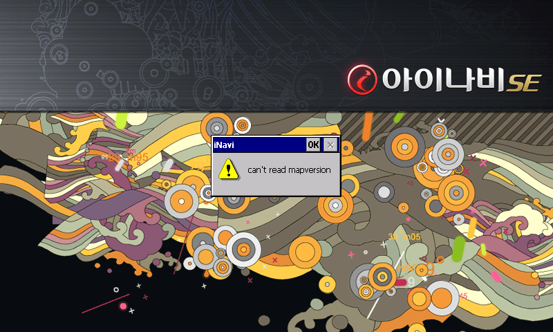
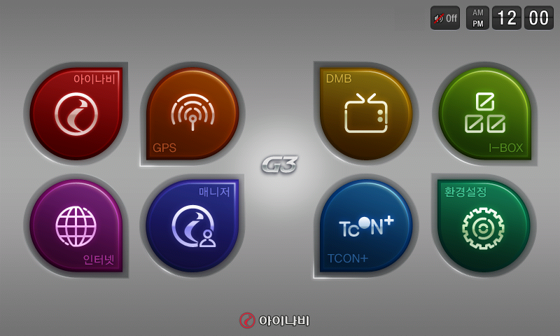

# Au1374 Core validation

The later full-card checkpoint completes map loading, Seoul Station search and
a 35.5 km route. See [functional boot validation](au13xx-inavi-functional-validation.md).
The app-only milestone and its missing-data diagnosis below are retained as history.

The 2026-11-15 checkpoint runs the original primary NAND partition through the
registered `inavi_gn2010` Core board. It reaches the original 800x480 launcher,
mounts the supplied INAVI archive on SD and launches `iNavi.exe` through real
calibrated pen input. No application or firmware binary is patched.

The missing-map dialog is an application-data boundary. In the supplied
`iNavi.exe`, function `00058B1C` displays `can't read mapversion` after
`0005B8CC` formats `%s\mapinfo.bin` and calls file reader `0013FE30`.
No file named `mapinfo.bin` exists in the 33-file supplied archive. An
independent FAT reader verified every archived file's SHA256 after mounting
the generated SD image. Map navigation is not established.

Two 75-second native runs ended with status0 after a requested graceful stop.
The second run touched the dialog's OK button; the original launcher logged
`WM_END_INAVI`, reopened the GPS port and became active again.

## Integration coverage

The [native Core harness](../../tools/au13xx_core_probe/README.md) contains
the 23 positive integration cases below. They use the real registered services,
the Engine guest clock and the supplied private input fixture. They are not a
CPU ISA conformance suite or a complete peripheral conformance suite.

| Suite | Cases | Coverage |
| --- | ---: | --- |
| Hardware |12| Bounded DMA continuation, GPIO DMA wake, NAND program/erase/status cursor, NAND UID access/restore, executable DMA coherence, OHCI frames/HCCA/IRQ, EHCI schedules/rollover/IRQ, VSS, codec control/ADC/power, DWC2 startup, peripheral snapshot/CPU-rate changes, Engine warm/cold reset delivery |
| Display/storage |5| SD configuration and absent-card timeout, LCD RGB565/raster edges, indexed palettes and pixel order, pipe alpha/cursor, frame-boundary shutdown |
| SD |3| Identification/RCA/CSD/packed SCR, original MBR bytes, volatile writes and mid-transfer restore |
| PCM audio |3| Halfword FIFO/overflow/stereo frame/DMA threshold, graceful drain/done acknowledgement, active FIFO/frame-phase restore across CPU-rate changes |

The independent Core UTF16 test also passes. The Engine's existing MIPS32R1,
CP0-selection, SPECIAL2 and bus-master coherence regressions were run during
bring-up. Normal Qt frontend acceptance and independent Core review remain
outstanding. The native host and earlier Engine-only probe remain diagnostic
scaffolding; their eventual removal is an acceptance obligation.

## Reproducible inputs

| Input | SHA256 |
| --- | --- |
| Original `dump_NAND_Part00.bin` | `ad1d54570ed71b019f37ff0bc139059b8bcd3821f16dad6c29b6558a39916057` |
| Original `INAVI.zip` | `98f9d9eb89ab9b3b6067f62c991cb05d7a7f669c3aa92309b09e6b64565221eb` |
| Reconstructed NAND | `3321b129e02b41259344d5401049a391eab8a0103e1f2812c15eb5ef394e8195` |
| Generated 64 MiB FAT16 SD | `b0f363a60cf3735036f9b37def8bf6da4fdd3e99ae6a23f9a009ae6049072e14` |

The NAND reconstruction is based on the logical OpenStore and partition
exports. Its synthesized OOB/ECC/FAL placement is experimental and does not
recover the original physical bad-block mapping. The factory UID sidecar
contains private input; no identity bytes are stored in source. Media writes
remain volatile and the original input hashes were checked after execution.

## Hardware grounding

The implementation uses chip manuals, standards, Linux register definitions
and reverse engineering of the supplied guest modules. Microsoft Device
Emulator and Windows CE Shared Source were not used. The source checkpoint
records these local reference paths under `references/au13xx/`:

| Behavior | Primary grounding |
| --- | --- |
| MIPS32R1 and CP0 | MIPS32 Architecture for Programmers, Volumes II/III; Linux Alchemy CPU capability definitions |
| Alchemy addresses/IRQs/DMA requests | Linux v6.12 `arch/mips/include/asm/mach-au1x00/au1000.h`, `au1xxx_dbdma.h`, `au1xxx_psc.h`; Alchemy Au1210/Au1250 Data Book |
| NAND geometry/protocol | Samsung K9F1208U0C Rev 1.1; original `nandfmd.dll` FAL scanner `C02F5B90` and ECC `C02F7D18` |
| Factory UID transaction | Original `NANDUUID.dll` command sequence; private sidecar data |
| USB startup | OpenHCI 1.0a, EHCI 1.0; Linux v6.12 `common/usb.c` and DWC2 `hw.h`; original `ohcd.dll`, `ehci.dll`, `au13xx_usbfn.dll` |
| SD protocol/controller | SD Physical Layer Simplified Specifications 1.10 and 7.10 (4.2.3,4.3.10,4.3.13,5.3.3,5.6); Linux v6.12 `au1xmmc.c`; original `sdio.dll` packed-data access `C0C03274` |
| LCD handoff | Original `ddi_au13xxlcd.dll` Samsung 800x480 table `C02C056C`; Alchemy LCD register descriptions and Linux v6.12 `au1200fb.h` |
| Touch calibration | Original `Touch.dll` target geometry `C027192C`, raw sample conversion `C0271C94`, and factory hive calibration data |
| PCM and codec | Alchemy Data Book section 7.4; original `psc_ac97.dll` transfer startup `C02E2A18`; Wolfson WM9705 Rev 4.5 |
| ITE startup boundary | Alchemy Data Book section 6.3.5.5; original `ite.dll` initialization `C0DC12EC` |

The Au1250-family documentation is applied to the observed Au1374 path only
where the guest behavior agrees; variant choices remain explicitly provisional.
Config words, external inputs, virtual SD identity/geometry, codec identity,
battery ADC value and enabled LCD handoff are not measured device facts.
Unmodeled active USB/ITE/codec-receive operations retain explicit fatal paths.
GPIO/I2C sensor and video models are incomplete. The host has no ALSA playback
device, so audible audio was not verified.

## Publication checks

A clean out-of-tree Linux Release build of `tools/au13xx_core_probe` passes.
CTest reports5/5 suites passing: the NAND-builder path tests plus the four
Core suites containing the23 positive integration cases listed above. The
portable FAT16 builder reproduces the SD image SHA256 recorded above exactly.
A recursive clone of the published Core fork retrieves the pinned Engine
revision and reproduces the local Core and Engine git trees exactly.
