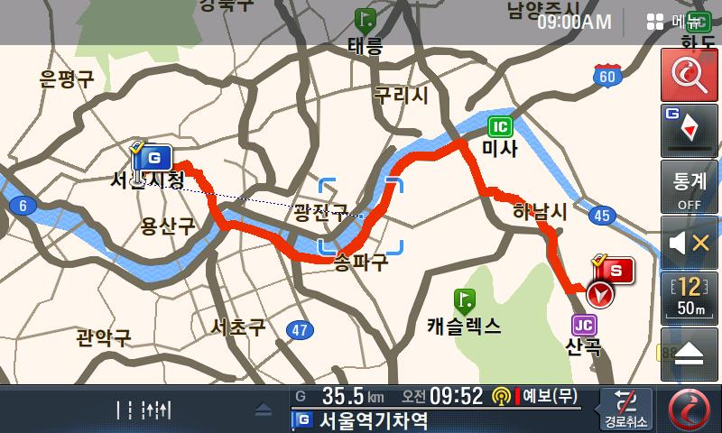
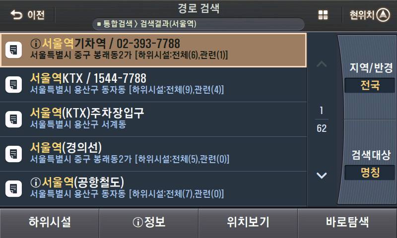

# Au1374 original-application functional boot

On 2026-11-15 the original Windows CE 6 firmware and unmodified iNavi SE
application loaded the supplied map data, returned 62 Seoul Station search
results and calculated a 35.5 km route to `서울역기차역`. The native Core
renderer displayed the road network, red route, start/destination markers,
distance and arrival estimate. No application, firmware, registry or GPS
position was patched to obtain the result.

## Storage and NAND extensions

The complete archive contains 2055 files totaling 6,880,048,244 bytes. The
former 64 MiB app-only image could not contain the missing map metadata and
databases. The new image has an 8 GiB capacity, an MBR partition starting at
sector 2048 and a FAT32 filesystem with 512-byte sectors and 4 KiB clusters.
Independent FAT reads reproduced all 2055 archive-file SHA256 values.

The SD card now uses an immutable read-only file with an in-memory overlay
for guest writes and erased ranges. CSD2, CMD8 voltage/pattern echo, ACMD41
HCS/CCS negotiation, SD 2.0 SCR and default-speed CMD6 status support SDHC
block addressing. High addresses are retained as 64-bit byte offsets. The
legacy 64 MiB SDSC profile retains its byte addressing and existing tests.
The 8 GiB overlay test snapshot occupies 844 bytes, including its protocol state.

The first full-card application run reached `NANDUUID.dll` function `C0CA2280`,
which uses the observed 30/65/read sequence with an additional page selector.
It reads 16-byte records from page 21. The former identity model accepted only
page 0. Addressed reads now support the separate 32-page small-page OTP block;
the private `.uid` input supplies captured and provisional page 0 bytes.
Uncaptured cells remain provisionally erased. An optional `.otp` input supplies a complete raw
32 × 528-byte block. This is separate from the normal reconstructed NAND array.

SDHC behavior is grounded in the SD Association's
[Physical Layer Simplified Specification 7.10](https://www.sdcard.org/wp-content/themes/sdcard-org/dl.php?f=Part1_Physical_Layer_Simplified_Specification_Ver7.10.pdf),
sections 4.2.3, 4.3.10.4, 4.3.13, 5.3.3 and 5.6. The OTP record transaction is
grounded in the supplied original driver, not a guessed application bypass.

## Functional checks

`tools/au13xx_core_probe/functional_boot_test.py` runs fresh native host
processes with the original ROM, reconstructed NAND, private UID and full SD
image. It drives the existing calibrated pen interface and captures the actual
Core renderer. Tesseract 5 with `kor+eng` recognizes map controls, the search
screen, the Seoul Station result header and the route destination/distance.
The route check also requires more than 3000 red path pixels in the map area,
excluding the toolbar. Checks do not inject guest messages, alter execution
registers or reuse a saved route. The supplied `routetbl.bin` is empty.

The manual run exited 0 after a requested graceful stop. Two further automated
cold boots passed the complete sequence, including route comparison and the
Start Guidance button. Both displayed the same destination, 35.5 km distance
and 09:52 arrival estimate from the provisional 09:00 clock. Their final route
frames are pixel-identical. All original input hashes remained unchanged.

| Rendered checkpoint | Cold boot 1 | Cold boot 2 |
| --- | ---: | ---: |
| Map visible | 123.05 s | 128.21 s |
| Search results | 149.23 s | 148.91 s |
| Route comparison | 185.96 s | 185.68 s |
| Guidance and destination visible | 194.12 s | 193.83 s |
| Clean exit, code 0 | 194.18 s | 193.95 s |

These are host wall times from process creation on the validation machine,
including full SD base-image identification. Peak private memory during the
manual run was454 MiB; the8 GiB card is not loaded into RAM. The existing
CTest suites passed5/5; the two additional SDHC scenarios passed separately.
[Machine-readable results](au1374-functional-results.json) record Core/Engine
revisions, host binary identity, OCR data identity and rendered-stage evidence.

## Remaining boundaries

This validates the native Core host's map, search and route path. It does not
establish normal Qt frontend or Android acceptance, live GPS/NMEA input,
audible host playback, active USB or ITE processing. Sensor initialization
retries continue in the background. Uncaptured OTP, provisional CPU/codec and
board inputs retain the limitations recorded in the Core validation document.
Private firmware, identity records and SD databases are not committed.
