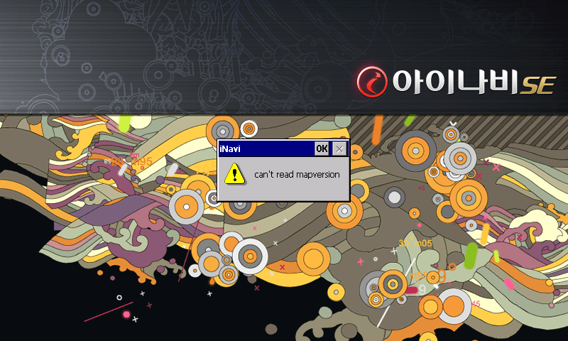

# Au1374 iNavi GN2010 port

The registered `inavi_gn2010` Core board boots the original Windows CE6 image
through the800x480 launcher, mounts the supplied INAVI files on SD, accepts
calibrated touch and starts the original iNavi executable. The current app
archive lacks `mapinfo.bin`, so iNavi displays its map-version error dialog.
Acknowledging that dialog returns cleanly to the launcher.

The port is experimental.23 hardware, display, SD and audio integration checks
pass in the native Linux development host. See [Core validation](au13xx-inavi-core-validation.md)
and the [reproducible host](../../tools/au13xx_core_probe/README.md). Normal Qt
frontend acceptance and independent Core review remain outstanding.

## Current implementation

- MIPS32R1 CP0 banks, TLB and exception handling, with DMA translation-cache coherence.
- Au1300-family clocks/counters, GPIC, descriptor DMA and UART debug output.
- Samsung small-page NAND with volatile writes, reconstructed FAL storage and a private UID sidecar.
- SD1 controller and SDSC card protocol with a deterministic64MiB FAT16 image.
- LCD raster timing, indexed palettes, RGB565, pipe priority, alpha and cursor rendering.
- Calibrated WM97xx-compatible pen input and PSC1 stereo PCM transmission.
- OHCI/EHCI/DWC2 startup, VSS clock/reset domains and observed ITE startup accesses.

The registered board is under `libCerfCore/src/boards/inavi_gn2010/`; SoC
models are under `libCerfCore/src/socs/au1300/`. The root and nested Engine
submodules pin the same revision. `.gitmodules` points to the port forks, so
`git clone --recurse-submodules` retrieves the implementation.

## Assumptions and remaining validation

Config0/Config1, external board inputs, virtual SD identity and geometry,
codec identity, battery ADC input and bootloader display handoff retain their
explicitly provisional status. The LCD handoff is selected from the original
driver's Samsung800x480 table, with its enabled state inferred. Original NAND
OOB and physical bad-block placement were not recovered. Guest media writes
remain volatile.

ITE processing, active USB transfers, DWC2 endpoints, AC97 receive and several
unreached display formats remain guarded by explicit fatal paths. Sensor and
video peripherals are incomplete. The validation environment has no ALSA
playback device; PCM timing and sample delivery were exercised through the
existing silent pacing backend, without audible verification.

No firmware, application files, device identity bytes or map database are
committed. The next application input is the original SD/map dataset, starting
with the missing `mapinfo.bin` file.

## Earlier CPU and Engine-only bring-up

The remaining sections preserve the earlier bring-up record. Statements about
unimplemented board support or future integration below describe that earlier
checkpoint; the execution status above is current.

## Source changes

`libCerfEngine` now distinguishes MIPS32 Release 1 from the existing MIPS I,
III and IV profiles. The new profile has 32-bit GPR semantics while enabling
the shared MOVN, MOVZ, PREF and ERET instructions. Doubleword instructions
remain unavailable. Conditional moves and comparisons operate on the
architectural word even when the upper half of the engine's register storage
contains another value.

The engine now forwards the three-bit CP0 `sel` field to the system host for
this profile. A host that implements only the old register interface still
handles selector zero and rejects other selectors. The Core bridge forwards
the selector to its CP0 model. Existing CPU models reject unimplemented banks;
they do not alias them to selector zero. Writes to a bank sharing register
number 12 do not apply the Status register's ERL handling.

Core configuration accepts `mips32r1` as an ISA choice. No existing board is
switched to this profile. An Au1300 CPU configuration and CP0 implementation
still need documented register values and reset behavior.

The MIPS32R1 decoder also accepts the integer SPECIAL2 operations `MADD`,
`MADDU`, `MSUB`, `MSUBU`, `MUL`, `CLZ` and `CLO`. The accumulator operations
use the 32-bit operands and the concatenated HI/LO words with modular 64-bit
arithmetic. `MUL` writes the low product word to its destination; its HI/LO
result remains architecturally unpredictable. Leading-bit counts operate on
the low word and enforce the manual's matching rt/rd encoding restriction.
The TX39 destination-register form of multiply-add keeps its separate feature
flag. Delay-slot classification tracks the new destination-register writes.

## Validation

Both the standalone Engine and Core libraries build on x86-64 Linux with
GCC 14.2 in Release mode. Core builds with its own nested Engine checkout;
both Engine checkouts select the same revision. The ten MIPS tests and the
Engine API test pass. The differential test now
includes 3,000 generated MIPS32R1 programs in normal and IR-verification modes,
in addition to the existing MIPS profiles. These modes share a frontend;
agreement is a regression check, not an independent ISA oracle.

Dedicated tests cover word-width comparisons and conditional moves with
different upper storage bits, ERET callback dispatch, doubleword rejection,
CP0 bank reads and writes, rejection of absent banks, rejection of selectors
on older ISA profiles, and compatibility with hosts using the old interface.
The Core UTF-16 test also passes. No GUI or peripheral acceptance test has run.

The SPECIAL2 test runs native programs in both IR modes, comparing results
with host arithmetic and bit-count references. It covers signed and unsigned
products, carry/borrow and accumulator wraparound, poisoned upper storage bits,
zero registers, destination/source aliases, every leading-bit position,
ordinary and likely branch delay slots, malformed encodings, ISA gating and
the existing TX39 multiply-add behavior. This ISA work does not implement the
CP0 configuration model needed by the follow-up original-ROM probe.

The public CP0 host fallback is included also when the translator is disabled.
A Linux configuration with a synthetic unsupported processor name builds the
library and the API test, which checks explicit no-backend refusal. This tests
that configuration with the host compiler; it does not test a foreign CPU.

## Original image startup experiment

A temporary bounded Engine test host ran the unmodified primary XIP from
`dump_NAND_Part00.bin`, SHA-256
`ad1d54570ed71b019f37ff0bc139059b8bcd3821f16dad6c29b6558a39916057`.

The host supplied zeroed memory at physical `0x00000000` through `0x0FFFFFFF`,
then copied the first XIP's `0x003722E4` bytes to physical `0x0FC7E000`.
Execution started at the `nk.exe` entry `0x8FC82450`, using the new MIPS32R1
profile, a 4 KiB minimum page size, 32 TLB slots and Status `0x00400004`.
CP0 storage was readable only after the guest initialized it. Count reads,
unknown CP0 reads, TLB operations and MMIO accesses stopped the experiment.
There were no interrupt sources or modeled peripheral clocks.

The trace reached the original `kernel.dll` entry at `0x8FC8E794` at
instruction index 1,196,192. The next traced instruction, at `0x8FC8E798`,
requested CP0 register 15 (PRId), which the probe rejected because its reset
value was not supplied. This is evidence that primary-image placement and
early kernel instructions can execute. It does not establish a correct
bootloader handoff, TLB behavior, scheduler, shell or application execution.

The secondary XIP was not loaded. Its linked range begins at `0x90000000`,
which direct KSEG0 folding would map to physical `0x10000000`, inside the
Au1300 peripheral area. A flat copy of the full partition into RAM is therefore
not a justified boot model. BINFS/NAND loading and any remapping must be
established before adding a board ROM placer.

The startup log is retained with the checkpoint. The temporary probe source
and executable are removed after the experiment; they are not a supported
emulator frontend.

## Historical next integration work

Implementation can continue from the supplied ROM, boot log and architecture
references. An EBOOT image or further hardware captures would refine the boot
handoff model and its validation; they are additional evidence for that work.

1. Implement the Au1300 CP0 model, including PRId, Config banks, masks,
   TLB geometry and reset behavior. The follow-up boot log identifies
   PRId `0x800C8001`; Config0 and Config1 remain unverified.
2. Supply the CPU clock, TLB and exception strategies, board context, memory
   map and boot arguments. Establish the secondary XIP's actual load path.
3. Run the original kernel through the Core and implement the first observed
   interrupt, timer and UART accesses against register documentation. UART TX
   must feed `KernelDebugSink` when reached.
4. Add the original drivers' storage, display and input paths, reach the shell,
   then exercise the supplied app. LL/SC and other unimplemented ISA paths
   remain an audit item. There is no map database in the supplied app archive.

[Follow-up captured boot evidence](au13xx-inavi-boot-evidence.md) records the
confirmed CPU identity, 792 MHz clock, NAND geometry, boot arguments and buffer
reservations. Its probe passes PRId and stops at the next Config0 read.

The two user-supplied behavior sources,
[WinCE_Emulator2](https://github.com/Royna2544/WinCE_Emulator2) and
[WinCE_Emulator3](https://github.com/Royna2544/WinCE_Emulator3), remain useful
for app-visible device protocols and comparison. This CPU checkpoint does not
transplant their Windows CE API replacements into CERF.

## Grounding and base revisions

- [Linux Alchemy CPU capabilities](https://github.com/torvalds/linux/blob/master/arch/mips/include/asm/mach-au1x00/cpu-feature-overrides.h):
  `cpu_has_mips32r1=1`, `cpu_has_64bits=0`, no FPU or MIPS16. Local copy:
  `references/au13xx/linux/arch/mips/include/asm/mach-au1x00/cpu-feature-overrides.h`,
  SHA-256 `b66310f8b8d7afcba6da5ab2918abdc540bea96b7bdb25d865b4b0714f641441`.
- MIPS Technologies, *MIPS32 Architecture for Programmers, Volume II*,
  revision 2.62, entries CLO (101), CLZ (102), ERET (122), MADD (156), MADDU (158),
  MFC0 (159), MOVN (169), MOVZ (173), MSUB (175), MSUBU (177), MTC0 (178),
  MUL (185) and PREF (201), printed page numbers.
  [Reference copy](https://www.cse.iitb.ac.in/~br/courses/cs305-autumn2011/labs/lab05/MD00086-2B-MIPS32BIS-AFP-02_62.pdf),
  local `references/au13xx/manuals/MIPS32_Vol2_2.62.pdf`, SHA-256
  `ce14f0f2039c51ee08753e55d18d80b01c0c13acd86fa7a6fc317211ec5578e8`.
- [Linux Alchemy address definitions](https://github.com/torvalds/linux/blob/master/arch/mips/include/asm/mach-au1x00/au1000.h)
  establish the Au1300 peripheral address area.
- CERF base: `e3a726eb116ed1b7d28ffff1c3601057dd7a3311`.
- Core base: `14f66037078585bf12eb2f0ac19a63a91800b612`.
- Engine base: `6e9a4062f3d86e45e346dac9156fa4bbaaf1d5b9`.

The initial strict probes used only established values. The later experimental
probe below uses explicitly provisional values to continue startup.
No ROM or application binaries are included in source commits.

## Au1374 startup experiment with provisional values

The user identified the SoC as Au1374 and authorized continued experiments:

> then stop reporting and plug a reasonable value and keep trying okay?

`tools/au13xx_startup_probe/` is an opt-in Linux Engine development tool,
separate from a registered Core board. Its README records the handoff,
register assumptions, references, regression cases and cleanup obligation.
Config0 defaults to `0x80000083`; Config1 defaults to `0x3E63318A`. Neither
word is a captured Au1374 value. Config1 chooses 32 paired TLB slots and
16 KiB I/D caches, with provisional four-way associativity and 32-byte lines.

The reconstructed tool builds in Release mode with warnings treated as
errors. Its regression executable passed, including actual same-VA Engine
execution through ASIDs 1/2/1 with distinct physical programs. The original
ROM completed OEMInit, printed the captured CPU identity and 792 MHz clock,
initialized the Samsung NAND path, then erased 3955 volatile blocks and made
68 FAL metadata program operations. Initial OOB reads address page `0x11A0`.

The optional logical NAND export is only a synthetic linear main-area import
with erased spare bytes. Its contents are discarded by the guest's format;
these results do not validate the original FAL mapping or mount the original
store. Zero boot arguments also select a different handoff branch from the
real device's good-signature boot. Subsequent address-error exceptions occur;
the guest-cycle budget is a termination condition, not boot acceptance.

The subsequent timer implementation delivers CPU Count/Compare and RTC/GPIC
interrupts through the original CE handlers. A synthetic raw NAND builder now
supplies the guest-derived FAL metadata and ECC; its run reaches the original
I2C and PSC0 SPI initialization. The DMA continuation passes the former
global-register boundary at physical `0x14003000` and initializes both SPI
DMA channels. The ECC encoder matches the original guest
function across 2116 sectors. The UART continuation then reaches the USB control
read at `0x1402102C` in `ohcd.dll`, after UART0/UART3 initialization.

The first independent runtime review found ten correctness and rule defects
outside the original tests. Follow-up regressions now cover executable DMA
writes, comparison length versus bus width, source/destination burst retention,
elapsed throttle requests, CPUPLL and UART rate changes, GPIO output readback,
explicit rejection of armed watchpoints, and descriptor-fetch arbitration.
The physical bus uses the Engine byte-order helpers. The new MIPS bus-master
coherence service also has a standalone Engine regression across two pages.
The next review identified nine further issues: physical-address truncation,
Cause.IV, reverse-endian controls, read-only CP0 fields, GPIO DMA routing,
receive-break acknowledgement, narrow 2D descriptors, manifest-path overwrites
and stale build/reference instructions. The corrected probe passes 22 CTest
cases, including regressions for those findings and unsupported GPIO DMA
selections. Regression results alone do not establish further boot milestones.
The third review found inconsistent level-low input detection and accepted but
unmodeled UART pin gating and counter bypass. Detection now follows PINVAL;
the unsupported output and external-clock controls halt at the write.
The ECC comparison includes
a complete single-bit basis for both
256-byte halves. The linear map is synthetic, not a recovered physical map.

No display, shell or iNavi execution is demonstrated. Its verified paths must move into
Core services, with UART TX connected to KernelDebugSink, before removing
the temporary probe. Original inputs are read-only and retain their hashes.
